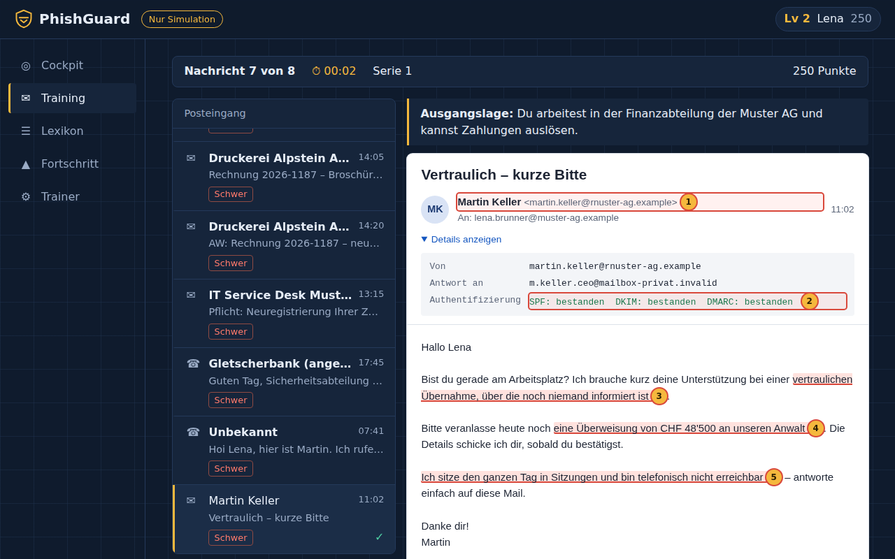
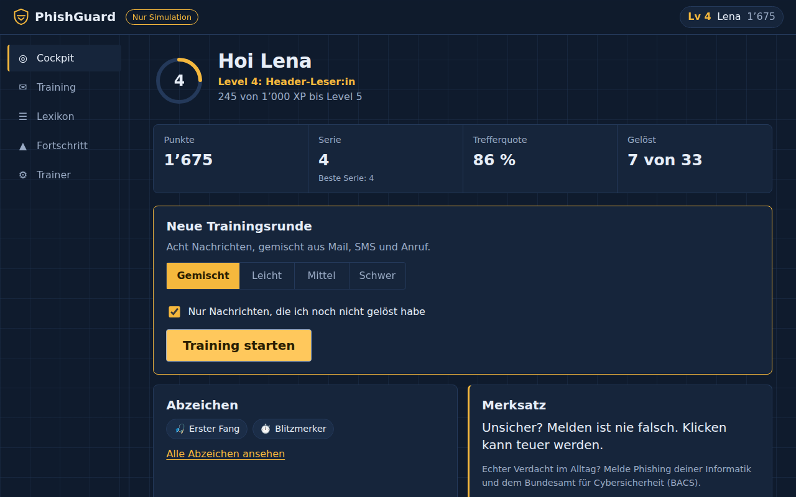
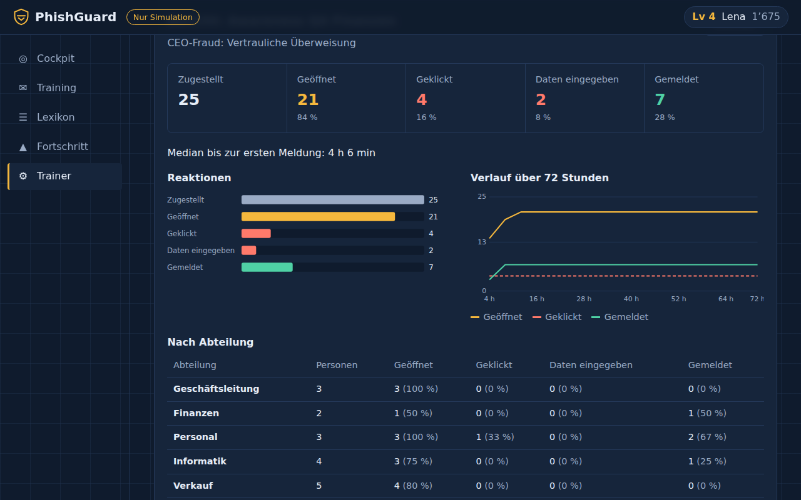
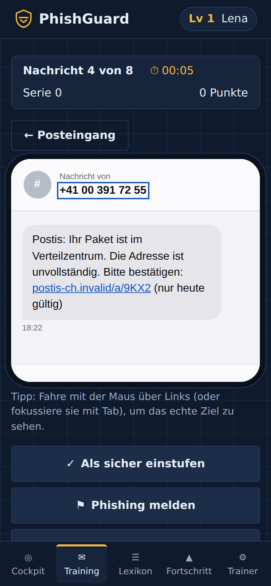
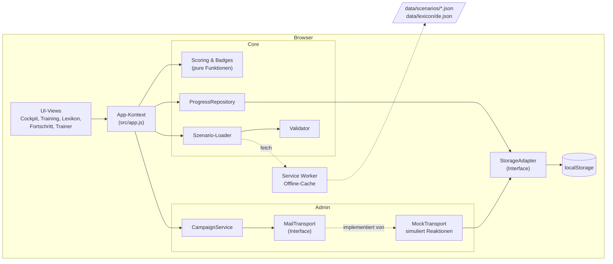

# PhishGuard

**Gamifizierter Phishing-Trainer für Schweizer KMU und Lernende.** Realistische Mails, SMS und Anrufe erkennen lernen – mit Punkten, Serien, Levels und einer Auswertung, die genau zeigt, woran man Phishing erkennt.

> [!IMPORTANT]
> **Reines Schulungs- und Simulationstool für Awareness-Training.** PhishGuard versendet keine Mails oder Nachrichten, ruft keine echten Websites auf und enthält keine echten Marken, Logos oder Domains. Alles passiert ausschliesslich im Browser.

**Demo:** https://peppigminze.github.io/phishguard/ *(nach dem ersten Deployment verfügbar)*



## Funktionen

- **Realistischer Mail-Client** mit Posteingang, Absender, Header-Details (Reply-To, Return-Path, SPF/DKIM/DMARC), Anhängen und Links mit Hover-Vorschau der echten Ziel-URL. Dazu ein SMS-Verlauf und Anrufprotokolle.
- **Drei Entscheidungen pro Nachricht:** sicher, Phishing melden oder darauf eingehen (Link/Anhang öffnen bzw. Anweisung befolgen).
- **Auswertung mit Beweis-Markierungen:** Nach dem Entscheid werden alle Merkmale in der Nachricht nummeriert hervorgehoben – Warnsignale rot, Echtheitszeichen grün – und einzeln erklärt.
- **Gamification:** Punkte nach Schwierigkeit, Zeitbonus, Serien-Multiplikator, 20 Levels, 14 Abzeichen, drei Schwierigkeitsgrade.
- **33 Schweiz-spezifische Szenarien**, davon 10 legitime (30 %), damit nicht blind alles gemeldet wird: Paketdienst, ÖV, Bank, Zahlungs-App, Steueramt, Telekom, Krankenkasse, CEO-Fraud, Rechnungsbetrug (IBAN-Wechsel), Konto-Login, Quishing (QR-Codes), Smishing und Vishing inklusive Deepfake-Anruf.
- **Trainer-Ansicht (simuliert):** Kampagne mit fiktiver Empfängerliste anlegen und «starten». Ein Mock-Transport simuliert Öffnungs-, Klick- und Melderaten; der Bericht zeigt Reaktionen, Verlauf über 72 Stunden und einen Vergleich nach Abteilung.
- **Lexikon** mit Merkmalen, Verhalten bei Verdacht und Schweizer Meldestellen (BACS, antiphishing.ch).
- **Fortschritt & Statistik** pro Profil, mehrere Profile pro Gerät, Export/Import als JSON.
- **PWA:** installierbar, offlinefähig, mobile-first, barrierearm (Tastatur, Screenreader, Kontrast, reduzierte Bewegung).

| Cockpit | Trainer-Bericht | Mobile |
|---|---|---|
|  |  |  |

## Tech-Stack

- **Vanilla JavaScript (ES-Module), ohne Framework und ohne Build-Tool** – null Laufzeit- und Entwicklungs-Abhängigkeiten, läuft direkt auf GitHub Pages ([Begründung](docs/adr/0001-architektur.md)).
- PWA mit Manifest und Service Worker (Precache-Liste wird beim Build generiert).
- Persistenz über eine abstrahierte Storage-Schicht (aktuell `localStorage`).
- Strenge Content Security Policy: Die App darf nur Dateien vom eigenen Ursprung laden.
- Tests mit dem eingebauten Node-Testrunner (`node --test`).

## Schnellstart

Voraussetzung: [Node.js](https://nodejs.org/) ab Version 22. Es muss nichts installiert werden.

```bash
git clone https://github.com/peppigminze/phishguard.git
cd phishguard
npm start            # http://localhost:5173
```

| Befehl | Zweck |
|---|---|
| `npm start` | Lokaler Dev-Server (erzeugt vorher die Precache-Liste) |
| `npm test` | Unit-Tests (Scoring, Validierung, Fortschritt, Mock-Transport, Szenario-Pack) |
| `npm run validate` | Alle Szenario-JSONs prüfen |
| `npm run balance` | Balancing-Bericht (Verteilung, maximale Punkte, erreichbares Level) |
| `npm run check` | Alles oben zusammen |
| `npm run build` | Statische Seite nach `_site/` bauen |

## Deployment auf GitHub Pages

1. Im Repository unter **Settings → Pages → Build and deployment** als Quelle **GitHub Actions** wählen.
2. Auf `main` pushen. Der Workflow [`.github/workflows/deploy.yml`](.github/workflows/deploy.yml) validiert die Szenarien, führt die Tests aus, baut `_site/` und veröffentlicht die Seite.

Weil alle Pfade relativ sind und das Routing über `#/…` läuft, funktioniert die App auch unter einem Unterpfad wie `/phishguard/`.

## Architektur



Die wichtigsten Entscheide sind in [`docs/adr/`](docs/adr/) dokumentiert:

- [0001 – Architektur ohne Framework und Build-Tool](docs/adr/0001-architektur.md)
- [0002 – Scoring und Balancing](docs/adr/0002-scoring.md)
- [0003 – MailTransport als Schnittstelle, nur Mock implementiert](docs/adr/0003-mail-transport.md)

### Projektstruktur

```
├── index.html, manifest.webmanifest, sw.js
├── src/
│   ├── main.js, app.js         Einstieg, App-Kontext
│   ├── core/                   Storage, Validator, Scoring, Badges, Fortschritt, Loader
│   ├── admin/                  MailTransport, MockTransport, Kampagnen, Empfänger
│   ├── ui/                     Router, DOM-Helfer, Charts, Nachrichten-Renderer, Views
│   ├── i18n/                   i18n.js + de.js (EN/FR vorbereitet)
│   └── styles/main.css
├── data/
│   ├── scenarios/              1 JSON-Datei pro Szenario + index.json
│   └── lexicon/de.json
├── tests/                      node --test
├── scripts/                    Dev-Server, Build, Validierung, Balancing
└── docs/                       Szenario-Schema, ADRs, Screenshots
```

## Roadmap

- [ ] Englisch und Französisch (UI über `src/i18n/`, Szenarien mit `locale`-Feld)
- [ ] Optionaler Firebase-Adapter für die Storage-Schicht (Team-Ranglisten)
- [ ] Weitere Szenario-Packs: Social Media, Business-Messenger, KI-generierte Mails
- [ ] Wiederholungsmodus für falsch beantwortete Szenarien (Spaced Repetition)
- [ ] Zertifikat (PDF) nach abgeschlossenem Pack
- [ ] Echter Versand nur als separates, eigenständiges Projekt mit Backend – siehe [ADR 0003](docs/adr/0003-mail-transport.md) und den Abschnitt «Rechtliches»

## Rechtliches

PhishGuard ist ein **reines Schulungs- und Simulationstool**. Es versendet nichts – weder Mails noch SMS – und alle Kampagnen in der Trainer-Ansicht sind Simulationen im Browser.

Wer in einem Unternehmen **echte Phishing-Simulationen** an Mitarbeitende verschicken möchte, muss Folgendes beachten:

- Es braucht eine **schriftliche Freigabe der Geschäftsleitung** bzw. des Auftraggebers.
- Die **Personalvertretung** (falls vorhanden) ist frühzeitig einzubeziehen; die Mitarbeitenden sollten generell über Awareness-Massnahmen informiert sein.
- Beim Umgang mit Personendaten (z. B. wer geklickt hat) gilt das **Datenschutzgesetz (DSG)**: Zweckbindung, Verhältnismässigkeit, Transparenz und angemessene Aufbewahrung. Auswertungen sollten wenn möglich anonymisiert oder aggregiert erfolgen und nicht für arbeitsrechtliche Massnahmen gegen Einzelne verwendet werden.
- Fremde Marken, Logos und echte Domains dürfen nicht ohne Erlaubnis verwendet werden.

Dieses Projekt enthält deshalb nur fiktive Marken («Postis», «Bahnix», «Twinto», «Gletscherbank», «Helvecom», «Officium 365» …) und ausschliesslich reservierte Domains (`.invalid`, `.example`). Ein Validator stellt das für jeden Beitrag automatisch sicher.

*Dies ist keine Rechtsberatung. Für konkrete Vorhaben bitte fachkundig beraten lassen.*

Echten Phishing-Verdacht in der Schweiz meldest du über [antiphishing.ch](https://www.antiphishing.ch) beim Bundesamt für Cybersicherheit (BACS).

## Mitwirken

Neue Szenarien sind sehr willkommen – es braucht dafür nur eine JSON-Datei. Anleitung und Regeln stehen in [CONTRIBUTING.md](CONTRIBUTING.md), das Format in [docs/scenario-schema.md](docs/scenario-schema.md). Sicherheitsprobleme bitte gemäss [SECURITY.md](SECURITY.md) melden.

## Lizenz

[MIT](LICENSE) © 2026 peppigminze

---

## English

**PhishGuard** is a gamified phishing-awareness trainer (PWA) aimed at Swiss SMEs and apprentices. Learners inspect realistic emails, text messages and phone-call transcripts, decide whether to trust, report or act on them, and get a detailed breakdown that highlights every red flag (or sign of legitimacy) directly in the message.

> **Simulation only.** Nothing is ever sent, no real websites are contacted, and the scenarios use fictional brands and reserved domains (`.invalid`, `.example`) exclusively.

**Highlights:** 33 Swiss-specific scenarios (30 % legitimate), email/SMS/voice channels including QR-code phishing and deepfake calls, points/streaks/levels/badges, a simulated trainer dashboard with a mock mail transport and campaign reports, offline-capable PWA, zero dependencies.

**Run locally:** Node.js 22+, then `npm start` and open http://localhost:5173. Tests: `npm test`. Deploy: set *Settings → Pages → Source* to *GitHub Actions* and push to `main`.

**Legal note:** Real phishing simulations against employees require written approval from management and should involve employee representatives; personal data must be handled according to the Swiss Federal Act on Data Protection (FADP/DSG). This project sends nothing.

The UI is currently German (Swiss spelling); the i18n layer is ready for English and French contributions.
